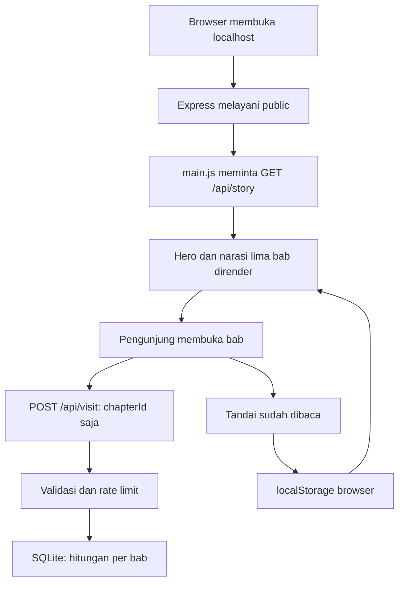

# Jejak Mbako

Website storytelling interaktif budaya Temanggung untuk pemuda, dengan alur **Kenali → Mainkan → Beraksi** dan Batik Mbako sebagai fokus cerita.

**Status: fase 1 selesai; narasi lima bab dan revisi desain sudah aktif.** Server, hero interaktif, navigasi, progres lokal, foto, narasi dengan rujukan, dan refleksi per bab tersedia. Peta, hotspot motif, stepper, galeri, kuis, misi, serta kartu digital belum diaktifkan; fase 2 belum selesai seluruhnya.

**Revisi visual 9 Oktober 2026:** foto kiriman pengguna terpasang pada bab 1–4; kolase alun-alun dan tugu jam menjadi latar hero dengan label hover/fokus dan panel klik/sentuh. Bab 5 mendapat komposisi original **Dengar, Catat, Ceritakan** sebagai pengantar ke aksi pemuda. Rincian aset, kredit yang belum dikonfirmasi, dan prompt imagegen ada di [docs/ASSETS.md](docs/ASSETS.md). Revisi visual ini belum menyelesaikan fitur fase 2.

**Revisi keterbacaan dan cerita:** atas permintaan pengguna, sumber cerita ditelusuri di internet dan narasi bab 1–5 dilengkapi. Palet pilihan pengguna adalah putih tulang `#f7f7f2`, arang `#20252c`, dan biru `#3156c9`. Font sistem Segoe UI/sans-serif menggantikan serif dekoratif; paragraf 18–19 px memakai lebar baca maksimal 730 px. Foto tampil selebar area bab dan sampai tepi layar ponsel. Bab 5 memakai foto alun-alun disertai ajakan original. Lihat [docs/SOURCES.md](docs/SOURCES.md) untuk batas verifikasi setiap rujukan.

Proyek berada di subfolder `jejak-mbako` atas pilihan pengguna. README ini menjadi acuan untuk subfolder ini, mengikuti dokumen `prompt-codex-jejak-mbako.md` terbaru. Aplikasi SURATin, package, dan README di folder induk tidak diubah. Rancangan endpoint pledge pada README induk tidak digunakan: backend proyek ini hanya menyimpan hitungan kunjungan bab.

## Menjalankan

Gunakan Node.js 22 atau lebih baru. Buka terminal di folder proyek ini:

```powershell
cd 'C:\Users\Aditya Wardani\Documents\Coding\SURATin\jejak-mbako'
npm start
```

Buka <http://localhost:3000>. Dependensi sudah dipasang dari cache lokal pada lingkungan pengerjaan. Hanya `express` dan `better-sqlite3` menjadi dependensi langsung; package turunannya dikelola npm. Tidak ada framework frontend, CDN, atau paket untuk pengujian tambahan.

Jika perlu memasang ulang pada mesin yang memiliki cache npm lengkap:

```powershell
npm ci --offline --ignore-scripts --no-audit --no-fund
```

Perintah ini tidak mengunduh dari internet. Jika cache tidak tersedia, instalasi offline tidak dapat dilakukan; siapkan dependensi untuk sistem operasi dan arsitektur mesin demo terlebih dahulu. `better-sqlite3` 13.0.3 yang digunakan memuat binary platform dalam package dan sudah diuji di Windows x64, Node.js 22.23.1.

```powershell
npm run dev
npm test
```

`dev` memantau perubahan server melalui fitur bawaan Node. Muat ulang browser setelah mengubah HTML, CSS, atau JavaScript. Setelah mengedit `data/story.json`, mulai ulang server agar isi JSON baru terbaca.

Port bawaan 3000, host bawaan `127.0.0.1`. Jika port terpakai, jalankan pada port lain:

```powershell
$env:PORT = '3001'
npm start
```

Untuk demonstrasi melalui ponsel di jaringan lokal, jalankan dengan `$env:HOST = '0.0.0.0'`, lalu buka alamat IP LAN komputer dan port yang dipilih. Ini opsional; bawaan hanya menerima koneksi dari komputer sendiri. Gunakan HTTPS dan konfigurasi reverse proxy yang sesuai jika kelak dipublikasikan; deployment bukan bagian fase 1.

## File yang dibuat dan fungsinya

| File | Fungsi |
| --- | --- |
| `package.json` | Mendefinisikan dua dependensi, versi Node, serta perintah menjalankan dan menguji aplikasi. |
| `package-lock.json` | Mengunci versi dependensi agar pemasangan dapat diulang secara konsisten. |
| `server.js` | Menjalankan Express, melayani API dan aset lokal, memvalidasi kunjungan, serta menambah hitungan SQLite. |
| `.gitignore` | Mengecualikan dependensi, database runtime, konfigurasi rahasia, dan file sementara dari Git. |
| `data/story.json` | Menyediakan seluruh struktur cerita dan konten persiapan fase berikutnya beserta kandidat sumber dan status verifikasi. |
| `public/index.html` | Menyusun hero, navigasi, tempat bab, bantuan penggunaan, sumber, dan footer yang semantik. |
| `public/assets/css/style.css` | Mengatur palet, tipografi, layout editorial responsif, rail, fokus keyboard, dan pengurangan gerak. |
| `public/assets/js/main.js` | Mengambil cerita, merender DOM, mengelola hotspot, progres lokal, navigasi bab, dan pengiriman ID bab saja. |
| `public/assets/images/lereng-temanggung.svg` | Menyediakan ilustrasi original dua gunung, kebun, matahari, dan ruang bertemu untuk hero. |
| `public/assets/images/motif-daun.svg` | Menyediakan pola daun original sebagai tekstur dan favicon, tanpa menyalin motif pengrajin. |
| `public/assets/images/placeholder.svg` | Menjadi gambar pengganti lokal ketika foto belum tersedia atau gagal dimuat. |
| `public/assets/fonts/.gitkeep` | Menyediakan folder kosong untuk font lokal yang akan ditambahkan pengguna. |
| `tests/server.test.js` | Menguji API, keamanan input, privasi skema database, persistensi, aset, dan rate limit melalui runner bawaan Node. |
| `README.md` | Menjelaskan penggunaan, konfigurasi, alur, keamanan, penggantian konten, serta bahan penjelasan kepada juri. |
| `docs/ASSETS.md` | Mencatat asal enam foto, penggunaan kolase AI, konsep bab 5, dan prompt penggabungan gambar. |
| `public/assets/images/hero-temanggung-kolase.png` | Menyediakan kolase alun-alun dan tugu jam sebagai latar hero yang interaktif. |
| `public/assets/images/bab-1-dua-gunung.png` | Menampilkan foto kiriman pertama untuk bab 1. |
| `public/assets/images/bab-2-daun-tembakau.png` | Menampilkan foto daun untuk bab 2. |
| `public/assets/images/bab-3-pengrajin.png` | Menampilkan foto pengerjaan kain untuk bab 3, termasuk watermark aslinya. |
| `public/assets/images/bab-4-detail-kain.png` | Menampilkan detail kain kiriman sebagai ilustrasi bab 4. |
| `public/assets/images/alun-alun-referensi.png` | Menyimpan foto asal alun-alun sebagai referensi kolase dan pembuka bab 5. |
| `docs/SOURCES.md` | Memetakan sumber narasi, tanggal penelusuran, dan batas informasi yang dikonfirmasi. |
| `public/assets/images/tugu-jam-referensi.png` | Menyimpan foto asal tugu jam sebagai referensi kolase. |

`data/jejak-mbako.db` dibuat otomatis saat server berjalan. SQLite juga dapat membuat file `-wal` dan `-shm`; seluruh file database tersebut diabaikan Git. File screenshot dan catatan uji sementara dapat disimpan di `tmp/`.

## Alur kerja fase 1

1. Node membaca `story.json`, membuka SQLite, dan menyiapkan server Express.
2. Browser meminta halaman HTML, CSS, JavaScript, dan SVG dari folder `public`.
3. `main.js` meminta `GET /api/story`, lalu membuat hero, rail navigasi, lima bab beserta narasi/foto/refleksi, serta daftar sumber yang digunakan.
4. Browser membaca progres lokal. Data lama yang rusak atau ID bab yang tidak dikenal tidak dipakai.
5. Saat sebuah bab dikunjungi, navigasi menandai bab aktif dan menyimpan posisi di browser.
6. Browser mengirim `{ "chapterId": "dua-gunung" }` ke server; SQLite hanya menambah hitungan bab itu.
7. Tombol **Tandai sudah dibaca** menyimpan tanda selesai di browser. Kunjungan tidak otomatis berarti sudah membaca.
8. Setelah reload, tombol **Lanjutkan bab** dan progres kembali. **Ulangi progres cerita** menghapus progres cerita saja.



## API dan penyimpanan

| Endpoint | Fungsi | Respons sukses |
| --- | --- | --- |
| `GET /api/health` | Memeriksa server dan koneksi database. | `200 { "status": "ok" }` |
| `GET /api/story` | Mengembalikan seluruh data cerita lokal. | `200` dan JSON cerita |
| `POST /api/visit` | Menambah hitungan satu bab yang diizinkan. | `201 { "ok": true }` |

Body POST hanya boleh memuat satu field `chapterId`. Lima ID bawaan: `dua-gunung`, `daun-penghidupan`, `lahirnya-mbako`, `daun-ke-kain`, dan `giliran-pemuda`. Daftar izin mengikuti array `bab` saat server dimulai. Gunakan ID unik yang cocok sebagai ID HTML, misalnya huruf kecil dan tanda hubung.

SQLite memiliki satu tabel `chapter_visits`, dengan kolom `chapter_id` dan `visits`. Tidak ada kolom nama, IP, timestamp kunjungan, cookie, hasil kuis, atau progres individu. Aplikasi tidak mencetak log request. Informasi jaringan tetap dibutuhkan sistem operasi untuk mengirim respons, tetapi tidak disimpan oleh aplikasi.

Hitungan adalah **jumlah kunjungan**, bukan jumlah orang unik. Browser mengirim paling banyak satu kunjungan untuk setiap bab selama satu pemuatan halaman; reload dapat menambah hitungan lagi. Tidak ada identifikasi pengguna atau pencegahan duplikasi lintas perangkat. Jika pengiriman gagal, progres membaca tetap bekerja dan pemberitahuan ditampilkan.

Utilitas localStorage membatasi key pada:

- `jejak-mbako.nickname`: disiapkan untuk nama panggilan pada fase berikutnya.
- `jejak-mbako.story-progress`: daftar bab yang ditandai dibaca dan bab terakhir dibuka; aktif pada fase 1.
- `jejak-mbako.mission-progress`: disiapkan untuk progres misi.
- `jejak-mbako.quiz-result`: disiapkan untuk hasil kuis.

Tiga key persiapan tidak ditulis sebelum fiturnya tersedia. Jika localStorage diblokir, aplikasi memakai memori sementara dan memberi pemberitahuan. Memori ini hilang setelah reload. Tidak ada pemanggilan `localStorage.clear()` yang dapat menghapus data aplikasi lain pada origin yang sama.

## Bagian kode yang penting

- `createApp()` di `server.js` memisahkan penyiapan aplikasi dari membuka port. Tes dapat memakai database sementara tanpa menyentuh database demo.
- `chapterIds` menolak ID asing, dan pengecekan field tambahan menolak kiriman nama atau data lain. Query `incrementVisit` memakai parameter `?` agar nilai input tidak menjadi bagian perintah SQL.
- `renderChapter()` membuat elemen DOM dengan `createElement()` dan `textContent`. Konten JSON ditampilkan sebagai teks, bukan dieksekusi sebagai HTML.
- `loadProgress()` hanya menerima ID yang masih ada di cerita dan menghapus duplikasi. Konten yang diperbarui tidak membuat progres lama menunjuk bab yang sudah dihapus.
- `readLocalData()` dan `saveLocalData()` menangani browser yang melarang penyimpanan agar pengalaman membaca tetap tersedia.
- `recordVisit()` mengirim satu field ID bab. Nama panggilan, hasil kuis, dan progres pribadi tidak disertakan.

## Keamanan fase 1

Header manual: CSP dengan sumber lokal, `X-Content-Type-Options: nosniff`, `X-Frame-Options: DENY`, `Referrer-Policy: no-referrer`, dan pembatasan kamera/mikrofon/lokasi/pembayaran melalui `Permissions-Policy`. Header `X-Powered-By` dinonaktifkan. Script dan style inline tidak diizinkan CSP.

POST menerima JSON maksimal 1 KB tanpa kompresi. Input tambahan, array, JSON rusak, ID asing, origin berbeda, dan request browser lintas situs ditolak. Tidak ada CORS terbuka, login, Helmet, API pihak ketiga, analytics, atau endpoint untuk mengirim data personal.

Rate limit global membatasi 120 request POST per 60 detik per proses. Penghitung disimpan di memori dan tidak menggunakan IP. Pembatasan ini sederhana untuk server demo lokal: pengguna berbagi batas yang sama, batas hilang setelah restart, dan tidak mengoordinasikan banyak instance. GET tetap tersedia ketika POST dibatasi.

Pesan error API ramah tanpa stack trace atau path server. Hanya folder `public` yang disajikan sebagai file statis, sehingga database dan source server tidak dapat diunduh melalui alamat aset.

## Mengganti konten, foto, dan font

Struktur `story.json`: `meta`, `hero`, `bab`, `peta`, `motifHotspot`, `proses`, `galeri`, `kuis`, `misi`, `ideUsaha`, dan `sumber`. Halaman merender hero, judul/ringkasan/foto/narasi/refleksi bab, dan sumber yang digunakan. `bab[].isi` berisi objek `{ "teks": "Paragraf", "sumberIds": ["id-rujukan"] }`. Tautan angka menuju catatan sumber pada halaman; tautan sumber eksternal baru diakses ketika diklik. `renungan` adalah pertanyaan refleksi. `visual: "manifesto"` menambahkan panel ajakan setelah narasi bab 5. Array fitur yang belum aktif tetap disiapkan untuk fase berikutnya.

Untuk mengubah atau menambah bab, edit array `bab`, gunakan ID unik, dan isi properti yang sama seperti bab lain. Rail, jumlah progres, serta tombol lanjut/kembali mengikuti jumlah bab. Mulai ulang server setelah perubahan data. Dua hotspot hero menggunakan class CSS sesuai ID `alun-alun` dan `tugu-jam`; mengubah jumlah/posisinya membutuhkan penyesuaian CSS. Foto bab memakai lebar penuh. Bab 4 ditampilkan sebagai crop lanskap; semua foto utuh dapat dibuka melalui Tentang foto. Foto bab 1 dan 4 masih beresolusi rendah sehingga ketajamannya terbatas saat diperbesar.

Setiap foto mempunyai `id`, `src`, `alt`, `kredit`, dan `status`. Foto kiriman yang sudah diminta pengguna untuk preview memakai file lokal dengan status `sementara` sampai kredit dan izinnya dikonfirmasi. SVG lokal tetap menjadi fallback jika file gagal dimuat. Untuk mengganti:

1. Letakkan foto berizin di `public/assets/images`.
2. Ganti `src` menjadi `/assets/images/nama-foto.jpg`.
3. Tulis `alt` sesuai isi foto dan `kredit` sesuai izin atau lisensi.
4. Ubah `status` menjadi `siap`; mulai ulang server dan reload browser.
5. Pastikan komposisi foto hero cocok dengan posisi hotspot. Posisi ilustrasi bukan koordinat geografis.

Foto berstatus `sementara` menampilkan lencana. Saat startup server mencetak seluruh foto sementara, termasuk yang belum dirender. Jika foto `siap` ternyata gagal dimuat, browser menampilkan SVG pengganti dan mengembalikan lencana sementara. Foto bab memakai lazy loading; hero dimuat lebih awal karena langsung terlihat.

| ID foto | Foto yang perlu disiapkan sebelum pengumpulan |
| --- | --- |
| `hero` | Kolase sudah terpasang; konfirmasi izin/kredit dua foto sumber dan pertahankan label kolase AI. |
| `bab-1` | Foto sudah terpasang; konfirmasi kredit, izin, serta lokasi, dan sediakan resolusi lebih besar bila ada. |
| `bab-2` | Foto daun sudah terpasang; konfirmasi fotografer, izin, dan lokasi. |
| `bab-3` | Foto pengerjaan kain sudah terpasang; konfirmasi sumber, izin, dan keterkaitannya dengan Batik Mbako. |
| `bab-4` | Detail kain sudah terpasang; konfirmasi nama motif, pembuat, dan izin. |
| `bab-5` | Memakai foto alun-alun yang sudah disediakan dan komposisi ajakan original. |
| `galeri-1` | Lanskap daerah. |
| `galeri-2` | Detail kain atau karya pengrajin. |
| `galeri-3` | Aktivitas pengrajin dengan izin. |

Tidak ada foto atau font situs lain yang diunduh. Enam foto berasal dari lampiran pengguna; kolase baru dihasilkan melalui imagegen atas permintaan penggabungan foto. Ketiga SVG dibuat untuk proyek ini dan tidak diklaim sebagai motif tradisional, motif dipatenkan, foto dokumentasi, atau peta akurat. Foto motif yang dikirim pengguna tetap diakui sebagai karya pihak lain dengan identitas/kredit yang belum dikonfirmasi.

`@font-face` sudah menunjuk `/assets/fonts/mbako-display.woff2` dan `/assets/fonts/mbako-sans.woff2`. Saat file belum disediakan, aplikasi menggunakan Segoe UI dan font sistem sans-serif tanpa meminta font yang hilang. Setelah menaruh font berlisensi yang sesuai, tambahkan `class="fonts-display-ready fonts-sans-ready"` pada elemen `body` di `index.html`. Kedua class boleh diaktifkan terpisah jika hanya salah satu font tersedia. Catat pembuat dan lisensi font di bagian kredit ini.

## Sumber dan verifikasi

Permintaan revisi pengguna mengizinkan penelusuran cerita di internet. Narasi memakai enam sumber dari Pemkab Temanggung, jurnal Islah UIN Salatiga, makalah Bandung Creative Movement, repositori UNY, dan UNESCO. Setiap paragraf faktual menautkan rujukannya. Sumber berstatus `diperiksa` tampil pada halaman; catatan kandidat untuk fitur lain tetap berada dalam JSON tetapi tidak ikut ditampilkan.

Tahun awal usaha, nama perintis, unsur motif, teknik batik, dan penelitian pewarna didukung sumber sesuai batas dalam [docs/SOURCES.md](docs/SOURCES.md). UNESCO dibaca lewat teks resmi terindeks karena pembukaan langsung dibatasi pemeriksaan browser. Klaim jumlah motif/paten tidak digunakan. Identitas kain pada foto, lokasi foto pengrajin, sejarah tugu, dan detail peta yang belum aktif masih memerlukan konfirmasi. Tidak ada angka ketinggian gunung atau narasi konsumsi tembakau.

## Cara menguji langkah demi langkah

1. Jalankan `npm test`. Delapan tes harus lulus; tes memakai database in-memory atau folder sementara, bukan database demo.
2. Jalankan `npm start` dan buka `http://localhost:3000`.
3. Arahkan kursor atau fokus keyboard pada kedua hotspot hero. Pastikan nama muncul, klik/sentuh membuka penjelasan, tombol Tutup bekerja, dan Escape menutup panel serta mengembalikan fokus.
4. Tekan Mulai Cerita, buka bab lewat rail, lalu gunakan Lanjut/Sebelumnya. URL fragment dan indikator bab aktif harus sesuai.
5. Tekan Tandai sudah dibaca pada satu bab. Progres menjadi 1 dari 5; reload dan pastikan progres serta tautan Lanjutkan bab kembali.
6. Tekan tombol yang sama untuk membatalkan tanda, atau Ulangi progres cerita untuk menghapus progres membaca.
7. Uji ukuran layar 360, 768, dan 1440 piksel. Pada ponsel rail berubah menjadi navigasi horizontal yang dapat digeser.
8. Gunakan Tab, Enter, dan Escape. Periksa fokus, skip link, bantuan penggunaan, dan akses tombol.
   Pada bab 5, buka panel Dengar, Catat, dan Ceritakan; pastikan setiap panel menampilkan langkah yang sesuai.
   Periksa 20 paragraf narasi dan enam entri sumber. Klik angka rujukan untuk menuju entri sumber yang disorot, lalu gunakan Back untuk kembali. Buka Tentang foto untuk kredit dan foto utuh.
9. Buka `/api/health` dan pastikan muncul `status: ok`. Pengujian otomatis mencakup kiriman ID tidak valid, field tambahan, JSON rusak, request besar, serta rate limit.
10. Untuk uji tanpa internet, matikan koneksi internet tetapi biarkan server lokal berjalan, kemudian reload. Jangan memilih mode DevTools yang memblokir localhost juga. Untuk uji kegagalan server, hentikan server lalu gunakan Coba lagi setelah menjalankannya kembali.

Offline berarti **tanpa internet dengan server lokal tetap aktif**, bukan aplikasi yang dapat dimuat ulang setelah server dimatikan. Fase 1 belum menyediakan service worker. Membuka file HTML langsung melalui `file://` tidak didukung. Tautan sumber hanya diakses jika pengguna membukanya sendiri.

## Pertanyaan juri dan jawaban singkat

Validasi pengerjaan fase 1: delapan tes backend lulus. Browser preview sudah diperiksa pada viewport 360, 768, dan 1440 piksel; luapan horizontal di ponsel sudah diperbaiki. Hotspot, tandai baca, pemulihan progres setelah reload, dan reset progres sudah dicoba. Tidak ada error/warning JavaScript yang tercatat pada pemeriksaan browser. Audit lintas browser dan pengujian offline menyeluruh tetap dijadwalkan pada fase 4.

Validasi revisi cerita dan tipografi: delapan tes backend kembali lulus dan `node --check public/assets/js/main.js` berhasil. Browser menampilkan lima bab, 20 paragraf, serta enam sumber; seluruh angka rujukan memiliki target. Viewport 360 dan 768 piksel tidak meluap secara horizontal; desktop 1440 piksel diperiksa secara visual. Progres bertahan setelah reload dan tanda uji dibatalkan kembali. Hotspot, Escape, label fokus, tautan rujukan, serta panel Dengar diuji. Konsol tidak menunjukkan error/warning. Pratinjau lokal tersimpan di `tmp/revisi-tipografi-cerita.jpg`.

1. **Mengapa memakai SQLite jika tidak ada login?** SQLite menyimpan hitungan kunjungan bab yang tetap ada setelah server dimatikan, tanpa memerlukan identitas pengunjung atau database online.
2. **Bagaimana menjaga data pengguna?** Progres pribadi tinggal di browser; API menolak field selain ID bab, dan tabel server hanya menyimpan ID serta hitungan.
3. **Bagaimana menambah cerita saat lomba?** Tambahkan objek bab di `story.json`, ikuti struktur yang tersedia, lalu mulai ulang server; navigasi dan jumlah progres terbentuk dari data.

## Batas fase dan kelanjutan

- Fase 1: fondasi backend dan frontend, hero, kerangka bab, data, progres lokal, dokumentasi dasar.
- Fase 2: narasi bab 1–5 sudah aktif pada revisi ini; peta ilustrasi, hotspot motif, dan stepper proses masih berikutnya.
- Fase 3: galeri geser, kuis, misi, ide usaha, serta kartu digital canvas.
- Fase 4: penyempurnaan, hardening, audit aksesibilitas, kompatibilitas lintas browser, offline, dan README final.

Prompt kelanjutan: **Lanjut fase 2 di subfolder jejak-mbako, mengikuti README di subfolder tersebut dan dokumen prompt terbaru.**
